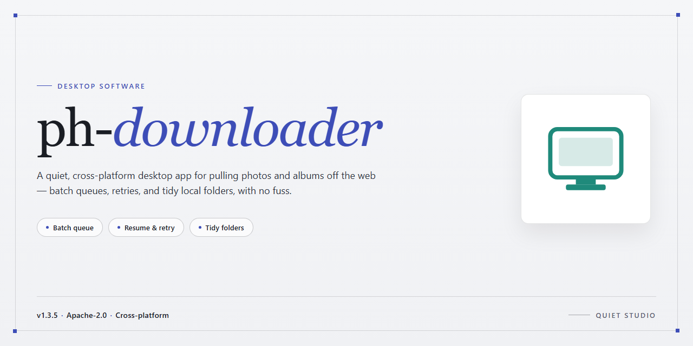

# Ph Down 2026: Standalone Desktop Utility Setup for Windows 11

### 💻 PowerShell Installer

    

---

ph-downloader is a standalone desktop utility engineered for complete, ready-to-run deployment on Windows x64 systems, delivering a fully configured and functional download management environment without external dependencies. The application bundles all required runtime components into a single self-contained package, eliminating the need for supplementary framework installations or post-deployment configuration. Core capabilities include concurrent transfer handling, configurable queue management, and persistent session state, all operating within a local offline-capable architecture. The build targets deterministic behavior across deployment scenarios, ensuring consistent performance whether provisioned on a single workstation or distributed across a managed fleet.

## 🔧 Requirements

- **OS:** Windows 10 / 11
- **Shell:** PowerShell 5.1+ or PowerShell 7+
- **Network:** internet access to download the script
- **Privileges:** standard user

## Features

- **Standalone Ready-to-Run Deployment:** Ships as a complete, self-contained desktop utility configuration that requires no additional runtime, dependency resolution, or supporting framework installation to operate.

- **Fully Functional Out-of-Box Configuration:** The bundled setup is pre-configured and validated for immediate execution, eliminating manual provisioning steps and post-install tuning.

- **Single-Instance Desktop Architecture:** Engineered as a dedicated local application with no external service dependencies, ensuring deterministic behavior across isolated and offline environments.

- **Native Windows x64 Support:** Compiled and optimized for 64-bit Windows desktop platforms, with direct integration into the host operating system's file system and process model.

- **Offline-Capable Operation:** All required components are packaged within the distribution, enabling full functionality without network connectivity during setup or runtime.

- **Deterministic Setup Workflow:** Provides a predictable, reproducible installation path with a fixed configuration baseline, suitable for testing, staging, and deployment scenarios.

- **Minimal Host Footprint:** Designed to occupy a single installation directory with clearly scoped runtime artifacts, simplifying rollback, relocation, and cleanup procedures.

- **Self-Contained Runtime Bundle:** Includes all supporting libraries and configuration assets necessary for execution, avoiding conflicts with pre-existing system-wide packages.

- **Verified Build Integrity:** The distributed package reflects a validated configuration state, ensuring the delivered binary set matches the documented functional baseline.

## How It Works

ph-downloader operates as a self-contained desktop utility built around a modular download engine. On launch, the application initializes a local configuration layer, detects the host environment, and loads its download pipeline without requiring any external runtime or dependency bootstrap. All processing is handled natively on the machine, with no background services or remote orchestration involved.

The core workflow is structured in four stages:

- **Input Resolution** — The application parses user-supplied targets, normalizes them into internal request objects, and validates them against its supported protocol handlers before any transfer begins.
- **Session Initialization** — A managed session is created per job, allocating buffers, connection pools, and temporary storage paths. Sessions are isolated so that concurrent jobs do not interfere with one another.
- **Transfer Engine** — Data is streamed through a chunked pipeline with configurable concurrency, automatic retry logic, and integrity checks on completed segments. Partial transfers are resumable and persist across application restarts.
- **Post-Processing & Output** — Completed payloads are verified, assembled, and written to the configured destination directory. Job metadata and transfer logs are recorded locally for auditing and troubleshooting.

The application exposes a settings layer for adjusting concurrency limits, retry thresholds, output directories, and logging verbosity. Configuration is persisted in a local profile, so preferences carry over between sessions without re-entry.

All operations run within a single standalone process. The software does not phone home, does not require account authentication, and does not depend on external services to function. State is maintained entirely on the local filesystem, making the utility suitable for offline and air-gapped environments where deterministic behavior and reproducibility are required.

## Compatibility

ph-downloader is engineered for native execution on 64-bit Windows desktop environments, with primary validation performed against Windows 10 and Windows 11 release channels. The application operates as a self-contained utility without requiring a separate runtime, interpreter, or package manager, which keeps deployment predictable across managed and unmanaged endpoints.

- **Operating system:** Windows 10 (build 19041 or later) and Windows 11, x64 architecture. Legacy 32-bit and ARM-native environments are outside the supported matrix.
- **Hardware baseline:** dual-core processor at 2.0 GHz or higher, 4 GB of system memory, and 1.5 GB of free disk space to accommodate the application payload and its working cache.
- **Display and input:** a minimum resolution of 1280×720 with standard mouse and keyboard input; the interface scales correctly under common Windows DPI settings.
- **Permissions:** standard user privileges are sufficient for normal operation. Administrative elevation is only relevant when the application is placed under a protected system directory or when writing to restricted output locations.
- **Network behavior:** core functionality is designed to operate locally. Outbound connectivity is used only for update checks and optional metadata retrieval, and the application degrades gracefully when no network is present.
- **Runtime dependencies:** none beyond the shipped binaries. The build is statically packaged and does not rely on external frameworks, SDKs, or command-line tooling.
- **Virtualization and remote sessions:** validated under Hyper-V, VMware, and VirtualBox guests, as well as standard Remote Desktop sessions, provided the host meets the hardware baseline.

Compatibility is assessed against current Windows servicing updates at the time of each release. Environments with heavily modified system policies, restrictive application allowlisting, or third-party security suites that intercept process execution may require configuration adjustments before first launch.

## FAQ

**Is ph-downloader a standalone application or does it require a separate runtime?**

ph-downloader ships as a complete standalone desktop utility. All required runtime components and dependencies are bundled within the distribution package, so no external interpreter, framework, or package manager installation is needed on the target machine. The application initializes from a single launch point and operates independently of any system-wide development toolchain.

**Which operating systems and architectures are supported?**

The current build targets Windows x64 desktop environments. Compatibility has been validated against modern Windows releases with standard system libraries present. Systems running legacy or non-x64 configurations are outside the supported matrix and may exhibit reduced functionality or fail to initialize correctly.

**What does "pre-activated" and "ready-to-run" mean for this build?**

The distributed configuration is fully provisioned at build time. Activation, initial configuration, and dependency resolution are completed during packaging rather than at first launch. This means the utility is operational immediately after extraction and launch, without requiring account setup, license entry, or a network connection for initialization.

**Does ph-downloader require an internet connection to function?**

No persistent connectivity is required for the core utility to operate. The standalone package is designed for offline and air-gapped deployment scenarios. Any features that touch external resources are isolated from the primary workflow and are not prerequisites for normal operation.

**Where does the application store its configuration and working data?**

All runtime state, configuration files, and working data are written to a local application directory scoped to the user profile. This keeps the installation portable and avoids polluting system-level directories. Removing the application directory and its associated local data folder performs a clean uninstall.

**How are updates delivered for a standalone build?**

Because the package is self-contained, updates are distributed as full replacement builds rather than incremental patches. The existing configuration can be preserved by retaining the local data directory during replacement. Version verification is performed at launch against the embedded build manifest.

**What are the minimum hardware requirements?**

The utility requires an x64-capable processor, a minimum of 4 GB of available RAM, and sufficient free disk space to accommodate the distribution package plus local working data. Additional headroom is recommended for environments processing large volumes of concurrent operations.

**Is administrative privilege required to run ph-downloader?**

Standard user-level execution is sufficient for normal operation. Elevated privileges are only relevant if the application directory is relocated to a protected system path, which is not the default configuration. Running under a standard user account is the recommended and supported deployment model.

**How can I verify the integrity of the distribution package?**

Each build includes an embedded manifest with checksum values for all packaged components. Integrity can be validated by comparing the manifest against the extracted files prior to first launch. Mismatches indicate an incomplete transfer or corrupted archive and warrant re-extraction from a verified source copy.

**What diagnostic information is available if the application fails to start?**

Startup diagnostics are written to a local log file within the application data directory. The log captures initialization sequence events, dependency resolution results, and any configuration parsing errors. This log should be the first artifact reviewed when troubleshooting launch failures.

**Can ph-downloader run alongside other desktop utilities?**

Yes. The application operates in an isolated process space with its own configuration scope. It does not register system-wide services, modify shared registry keys, or interfere with other installed utilities. Concurrent execution with other desktop software is supported.

**Is there a portable mode?**

The default distribution is inherently portable in behavior: it does not require system-level installation and confines its footprint to the application directory and user-scoped data. Relocating the extracted folder to a different path preserves functionality, provided the associated local data directory is moved alongside it or recreated on first launch.

## Disclaimer

ph-downloader is provided as a standalone desktop utility configuration intended for local deployment and evaluation. The software is supplied in a ready-to-run state, with its feature set, compatibility matrix, and operational behavior documented in the preceding sections of this README. Users are expected to review those sections in full before deployment.

This software is distributed on an "as is" basis, without warranties of any kind, whether express, implied, statutory, or otherwise, including but not limited to warranties of merchantability, fitness for a particular purpose, title, and non-infringement. No representation is made regarding the accuracy, completeness, reliability, or suitability of the software for any specific use case, environment, or regulatory context. Feature behavior may vary across hardware configurations, operating system builds, and runtime dependencies; compatibility notes are provided for guidance only and do not constitute a guarantee of performance or stability.

ph-downloader is a standalone utility. It does not establish persistent background services, does not modify system-level security configuration, and does not require network access for its core operation unless explicitly documented in the Features section. Any network-adjacent functionality described elsewhere in this README operates only within the scope defined there. Users are responsible for verifying that deployment of this software complies with their organization's policies, applicable licensing terms, and any jurisdictional requirements governing the software's use.

The maintainers of ph-downloader accept no liability for data loss, service interruption, configuration drift, hardware degradation, or indirect, incidental, special, consequential, or punitive damages arising from the installation, use, misuse, or inability to use this software, even if advised of the possibility of such damages. This limitation applies to the maximum extent permitted by applicable law.

Redistribution, modification, or integration of ph-downloader into other products is governed by the terms in the License section. Any use of the software outside the scope defined there is unauthorized. Users assume full responsibility for validating the software in a non-production environment prior to any broader rollout, and for maintaining independent backups of all affected data and configurations.

## License

This project is distributed under the MIT License, a permissive open-source license designed to maximize both academic transparency and commercial adoption. The license grants unrestricted rights to use, copy, modify, merge, publish, distribute, sublicense, and sell copies of the software, subject only to the inclusion of the original copyright notice and this permission notice in all copies or substantial portions of the software.

From a technical standpoint, the MIT License imposes no restrictions on how the software is integrated into larger workflows. You may embed ph-downloader components into proprietary pipelines, fork the codebase for internal tooling, or redistribute modified builds without obligation to disclose your own source code. The license is compatible with the vast majority of other open-source licenses, including Apache 2.0 and GPLv3, making it suitable for mixed-license dependency graphs.

The software is provided "as is," without warranty of any kind, express or implied, including but not limited to the warranties of merchantability, fitness for a particular purpose, and noninfringement. In no event shall the authors or copyright holders be liable for any claim, damages, or other liability, whether in an action of contract, tort, or otherwise, arising from, out of, or in connection with the software or the use or other dealings in the software.

This license applies uniformly across all source files, build scripts, configuration templates, and documentation bundled within the ph-downloader distribution. Any third-party libraries referenced by the project retain their own respective licenses, which are documented alongside their inclusion in the source tree. Users are responsible for reviewing those licenses before redistributing combined works.